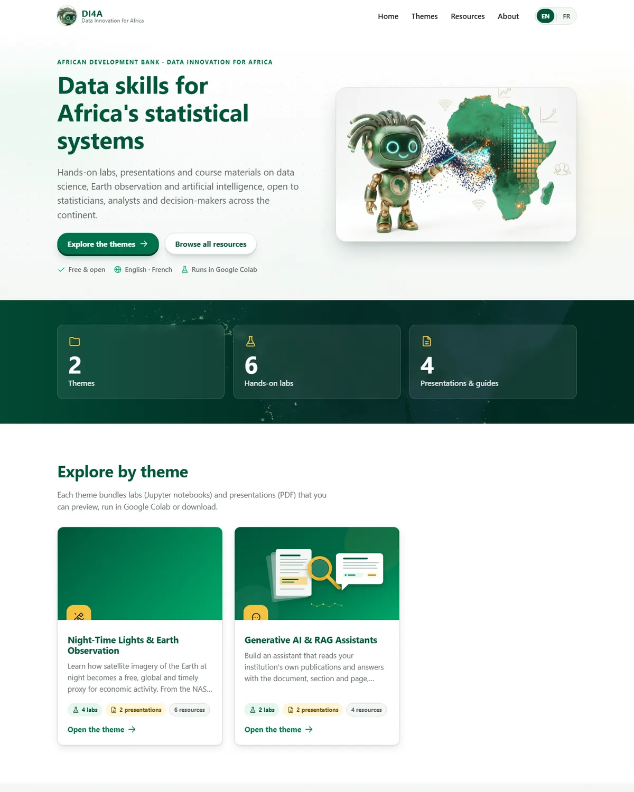
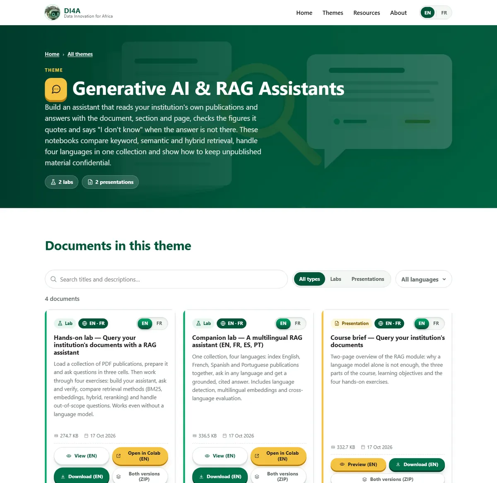

<p align="center">
  
</p>

<h1 align="center">Data Innovation for Africa (DI4A) — Learning Resources</h1>

<p align="center">
  <a href="https://github.com/datainnov4africa-web/DI4A-Website/actions/workflows/deploy.yml"></a>
  <a href="https://datainnov4africa-web.github.io/DI4A-Website/"></a>
  <a href="#licence--licence"></a>
  <a href="#licence--licence"></a>
  
</p>

<p align="center">
  <a href="#english">English</a> · <a href="#français">Français</a>
</p>

---

## English

**Data Innovation for Africa (DI4A)** is an initiative of the African Development Bank's Statistics Department. It helps national statistical offices, central banks and public institutions harness new data sources (satellite imagery, big data, artificial intelligence) to produce timelier, more granular statistics.

This repository hosts the **official DI4A website**: a bilingual (EN/FR) catalogue of hands-on labs (Jupyter notebooks) and presentations (PDF), organised by theme. Every document can be previewed, opened in Google Colab or downloaded under a descriptive file name.

🌍 **Live site:** <https://datainnov4africa-web.github.io/DI4A-Website/>

<p align="center">
  
</p>

### Catalogue

The tables below are regenerated automatically by the deployment workflow.

<!-- CATALOG-EN:START -->
| Theme | Labs | Presentations | Page |
|---|:-:|:-:|---|
| **Data Innovation Framework & Maturity Model** | 0 | 2 | [https://datainnov4africa-web.github.io/DI4A-Website/themes/framework/](https://datainnov4africa-web.github.io/DI4A-Website/themes/framework/) |
| **Night-Time Lights & Earth Observation** | 3 | 5 | [https://datainnov4africa-web.github.io/DI4A-Website/themes/ntl/](https://datainnov4africa-web.github.io/DI4A-Website/themes/ntl/) |
| **Connectivity Data & Big Data at Scale** | 2 | 3 | [https://datainnov4africa-web.github.io/DI4A-Website/themes/ookla/](https://datainnov4africa-web.github.io/DI4A-Website/themes/ookla/) |
| **Price Statistics & Alternative Data for the CPI** | 1 | 2 | [https://datainnov4africa-web.github.io/DI4A-Website/themes/cpi/](https://datainnov4africa-web.github.io/DI4A-Website/themes/cpi/) |
| **Generative AI & RAG Assistants** | 2 | 2 | [https://datainnov4africa-web.github.io/DI4A-Website/themes/rag/](https://datainnov4africa-web.github.io/DI4A-Website/themes/rag/) |

<details><summary><b>Data Innovation Framework & Maturity Model</b> — 2 documents</summary>

- **Presentation** — Establishing a data innovation lab: a practical guide to applying the AfDB's Data Innovation Maturity Model — [EN](https://datainnov4africa-web.github.io/DI4A-Website/files/framework/Establishing_A_Data_Innovation_Lab_Practical_Guide_To_The_Maturity_Model_EN_AfDB_DI4A.pdf) <sub>(2.4 MB)</sub>
- **Presentation** — Establishing a data innovation lab — slides — [EN](https://datainnov4africa-web.github.io/DI4A-Website/files/framework/Establishing_A_Data_Innovation_Lab_Maturity_Model_Slides_EN_AfDB_DI4A.pdf) <sub>(603.7 KB)</sub> · [FR](https://datainnov4africa-web.github.io/DI4A-Website/files/framework/Establishing_A_Data_Innovation_Lab_Maturity_Model_Slides_FR_AfDB_DI4A.pdf) <sub>(616.5 KB)</sub>

</details>

<details><summary><b>Night-Time Lights & Earth Observation</b> — 8 documents</summary>

- **Presentation** — Night-time lights: what darkness tells us — [EN](https://datainnov4africa-web.github.io/DI4A-Website/files/ntl/Night_Time_Lights_What_Darkness_Tells_Us_Concepts_And_Instruments_EN_AfDB_DI4A.pdf) <sub>(1.6 MB)</sub> · [FR](https://datainnov4africa-web.github.io/DI4A-Website/files/ntl/Night_Time_Lights_What_Darkness_Tells_Us_Concepts_And_Instruments_FR_AfDB_DI4A.pdf) <sub>(1.6 MB)</sub>
- **Presentation** — Night lights: from satellite to statistics — the three-notebook series — [EN](https://datainnov4africa-web.github.io/DI4A-Website/files/ntl/Night_Lights_Series_From_Satellite_To_Statistics_Three_Notebooks_EN_AfDB_DI4A.pdf) <sub>(957.7 KB)</sub> · [FR](https://datainnov4africa-web.github.io/DI4A-Website/files/ntl/Night_Lights_Series_From_Satellite_To_Statistics_Three_Notebooks_FR_AfDB_DI4A.pdf) <sub>(972.0 KB)</sub>
- **Lab** — Lab 1 — Data collection: NASA Black Marble (VNP46) — [EN](https://datainnov4africa-web.github.io/DI4A-Website/files/ntl/Night_Time_Lights_Lab_1_Data_Collection_NASA_Black_Marble_EN_AfDB_DI4A.ipynb) <sub>(149.7 KB)</sub> · [FR](https://datainnov4africa-web.github.io/DI4A-Website/files/ntl/Night_Time_Lights_Lab_1_Data_Collection_NASA_Black_Marble_FR_AfDB_DI4A.ipynb) <sub>(155.8 KB)</sub>
- **Lab** — Lab 2 — Anatomy of a Black Marble file (HDF5) — [EN](https://datainnov4africa-web.github.io/DI4A-Website/files/ntl/Night_Time_Lights_Lab_2_Anatomy_Of_A_Black_Marble_File_EN_AfDB_DI4A.ipynb) <sub>(572.2 KB)</sub> · [FR](https://datainnov4africa-web.github.io/DI4A-Website/files/ntl/Night_Time_Lights_Lab_2_Anatomy_Of_A_Black_Marble_File_FR_AfDB_DI4A.ipynb) <sub>(585.7 KB)</sub>
- **Lab** — Lab 3 — Night-time lights and economic activity — [EN](https://datainnov4africa-web.github.io/DI4A-Website/files/ntl/Night_Time_Lights_Lab_3_Night_Lights_And_Economic_Activity_EN_AfDB_DI4A.ipynb) <sub>(626.3 KB)</sub> · [FR](https://datainnov4africa-web.github.io/DI4A-Website/files/ntl/Night_Time_Lights_Lab_3_Night_Lights_And_Economic_Activity_FR_AfDB_DI4A.ipynb) <sub>(630.9 KB)</sub>
- **Presentation** — Get a NASA Earthdata token for night-lights data — [EN](https://datainnov4africa-web.github.io/DI4A-Website/files/ntl/Get_A_NASA_Earthdata_Token_For_Night_Lights_Data_EN_AfDB_DI4A.pdf) <sub>(432.6 KB)</sub> · [FR](https://datainnov4africa-web.github.io/DI4A-Website/files/ntl/Get_A_NASA_Earthdata_Token_For_Night_Lights_Data_FR_AfDB_DI4A.pdf) <sub>(417.0 KB)</sub>
- **Presentation** — Registering for Google Earth Engine — step-by-step guide — [EN](https://datainnov4africa-web.github.io/DI4A-Website/files/ntl/Registering_For_Google_Earth_Engine_Step_By_Step_Guide_EN_AfDB_DI4A.pdf) <sub>(2.0 MB)</sub> · [FR](https://datainnov4africa-web.github.io/DI4A-Website/files/ntl/Registering_For_Google_Earth_Engine_Step_By_Step_Guide_FR_AfDB_DI4A.pdf) <sub>(2.0 MB)</sub>
- **Presentation** — Generate a GitHub API key (personal access token) — [EN](https://datainnov4africa-web.github.io/DI4A-Website/files/ntl/Generate_A_GitHub_Personal_Access_Token_Step_By_Step_EN_AfDB_DI4A.pdf) <sub>(1.3 MB)</sub> · [FR](https://datainnov4africa-web.github.io/DI4A-Website/files/ntl/Generate_A_GitHub_Personal_Access_Token_Step_By_Step_FR_AfDB_DI4A.pdf) <sub>(1.3 MB)</sub>

</details>

<details><summary><b>Connectivity Data & Big Data at Scale</b> — 5 documents</summary>

- **Lab** — Lab — Measuring the connectivity gap with Ookla Open Data and WorldPop — [EN](https://datainnov4africa-web.github.io/DI4A-Website/files/ookla/Connectivity_Gap_Ookla_Open_Data_And_WorldPop_Lab_EN_AfDB_DI4A.ipynb) <sub>(249.6 KB)</sub> · [FR](https://datainnov4africa-web.github.io/DI4A-Website/files/ookla/Connectivity_Gap_Ookla_Open_Data_And_WorldPop_Lab_FR_AfDB_DI4A.ipynb) <sub>(257.6 KB)</sub>
- **Presentation** — Measuring the connectivity gap with Ookla Open Data — slides — [EN](https://datainnov4africa-web.github.io/DI4A-Website/files/ookla/Connectivity_Gap_Ookla_Open_Data_And_WorldPop_Slides_EN_AfDB_DI4A.pdf) <sub>(995.7 KB)</sub> · [FR](https://datainnov4africa-web.github.io/DI4A-Website/files/ookla/Connectivity_Gap_Ookla_Open_Data_And_WorldPop_Slides_FR_AfDB_DI4A.pdf) <sub>(1001.1 KB)</sub>
- **Presentation** — Engines of scale: big data technologies for statistical systems — [EN](https://datainnov4africa-web.github.io/DI4A-Website/files/ookla/Engines_Of_Scale_Big_Data_Technologies_For_Statistical_Systems_EN_AfDB_DI4A.pdf) <sub>(1.0 MB)</sub> · [FR](https://datainnov4africa-web.github.io/DI4A-Website/files/ookla/Engines_Of_Scale_Big_Data_Technologies_For_Statistical_Systems_FR_AfDB_DI4A.pdf) <sub>(1.1 MB)</sub>
- **Lab** — Lab — Ookla at scale with Elasticsearch and Kibana — [EN](https://datainnov4africa-web.github.io/DI4A-Website/files/ookla/Ookla_At_Scale_With_Elasticsearch_And_Kibana_Lab_EN_AfDB_DI4A.ipynb) <sub>(135.7 KB)</sub> · [FR](https://datainnov4africa-web.github.io/DI4A-Website/files/ookla/Ookla_At_Scale_With_Elasticsearch_And_Kibana_Lab_FR_AfDB_DI4A.ipynb) <sub>(139.7 KB)</sub>
- **Presentation** — Searching, aggregating and mapping big data with the Elastic Stack — slides — [EN](https://datainnov4africa-web.github.io/DI4A-Website/files/ookla/Ookla_At_Scale_With_The_Elastic_Stack_Slides_EN_AfDB_DI4A.pdf) <sub>(977.6 KB)</sub> · [FR](https://datainnov4africa-web.github.io/DI4A-Website/files/ookla/Ookla_At_Scale_With_The_Elastic_Stack_Slides_FR_AfDB_DI4A.pdf) <sub>(986.5 KB)</sub>

</details>

<details><summary><b>Price Statistics & Alternative Data for the CPI</b> — 3 documents</summary>

- **Presentation** — The consumer price index: from COICOP 2018 to online prices — [EN](https://datainnov4africa-web.github.io/DI4A-Website/files/cpi/Consumer_Price_Index_COICOP_Classification_And_Online_Prices_EN_AfDB_DI4A.pdf) <sub>(1.0 MB)</sub> · [FR](https://datainnov4africa-web.github.io/DI4A-Website/files/cpi/Consumer_Price_Index_COICOP_Classification_And_Online_Prices_FR_AfDB_DI4A.pdf) <sub>(1.0 MB)</sub>
- **Lab** — Lab — Online price index: aggregation, COICOP classification and index computation — [EN](https://datainnov4africa-web.github.io/DI4A-Website/files/cpi/Online_Price_Index_Analysis_And_COICOP_Classification_Lab_EN_AfDB_DI4A.ipynb) <sub>(43.3 KB)</sub> · [FR](https://datainnov4africa-web.github.io/DI4A-Website/files/cpi/Online_Price_Index_Analysis_And_COICOP_Classification_Lab_FR_AfDB_DI4A.ipynb) <sub>(469.3 KB)</sub>
- **Presentation** — Installing Python and JupyterLab — step-by-step guide — [EN](https://datainnov4africa-web.github.io/DI4A-Website/files/cpi/Installing_Python_And_JupyterLab_Step_By_Step_Guide_EN_AfDB_DI4A.pdf) <sub>(473.9 KB)</sub> · [FR](https://datainnov4africa-web.github.io/DI4A-Website/files/cpi/Installing_Python_And_JupyterLab_Step_By_Step_Guide_FR_AfDB_DI4A.pdf) <sub>(485.2 KB)</sub>

</details>

<details><summary><b>Generative AI & RAG Assistants</b> — 4 documents</summary>

- **Presentation** — Query your institution's documents with RAG — concepts, hands-on guide and reference briefing — [EN](https://datainnov4africa-web.github.io/DI4A-Website/files/rag/RAG_For_Statistical_Publications_Concepts_Hands_On_And_Reference_Briefing_EN_AfDB_DI4A.pdf) <sub>(827.1 KB)</sub> · [FR](https://datainnov4africa-web.github.io/DI4A-Website/files/rag/RAG_For_Statistical_Publications_Concepts_Hands_On_And_Reference_Briefing_FR_AfDB_DI4A.pdf) <sub>(834.7 KB)</sub>
- **Lab** — Hands-on lab — Query your institution's documents with a RAG assistant — [EN](https://datainnov4africa-web.github.io/DI4A-Website/files/rag/RAG_Assistant_For_Statistical_Publications_Hands_On_Lab_EN_AfDB_DI4A.ipynb) <sub>(272.2 KB)</sub> · [FR](https://datainnov4africa-web.github.io/DI4A-Website/files/rag/RAG_Assistant_For_Statistical_Publications_Hands_On_Lab_FR_AfDB_DI4A.ipynb) <sub>(284.9 KB)</sub>
- **Lab** — Companion lab — A multilingual RAG assistant (EN, FR, ES, PT) — [EN](https://datainnov4africa-web.github.io/DI4A-Website/files/rag/Multilingual_RAG_Assistant_English_French_Spanish_Portuguese_EN_AfDB_DI4A.ipynb) <sub>(335.0 KB)</sub> · [FR](https://datainnov4africa-web.github.io/DI4A-Website/files/rag/Multilingual_RAG_Assistant_English_French_Spanish_Portuguese_FR_AfDB_DI4A.ipynb) <sub>(370.9 KB)</sub>
- **Presentation** — Two free API keys: Groq and Gemini, step by step — [EN](https://datainnov4africa-web.github.io/DI4A-Website/files/rag/Two_Free_LLM_API_Keys_Groq_And_Gemini_Step_By_Step_EN_AfDB_DI4A.pdf) <sub>(371.3 KB)</sub> · [FR](https://datainnov4africa-web.github.io/DI4A-Website/files/rag/Two_Free_LLM_API_Keys_Groq_And_Gemini_Step_By_Step_FR_AfDB_DI4A.pdf) <sub>(380.7 KB)</sub>

</details>
<!-- CATALOG-EN:END -->

### How to add a theme or a document (3 steps)

1. **Create or open a theme folder** under `content/`, for example `content/Machine-Learning/`. The folder name becomes the theme's URL (`themes/machine-learning/`).
2. **Drop your files** in it. Only `.ipynb` (published as *Labs*) and `.pdf` (published as *Presentations*) are shown; every other format is ignored. Optionally add a `_meta.yml` with bilingual titles, descriptions, an icon, a cover image and the descriptive download name of each file (see [`content/NTL/_meta.yml`](content/NTL/_meta.yml)).
   **Bilingual documents:** name the two versions with a language suffix, `Data_Visualization_EN.pdf` and `Data_Visualization_FR.pdf`. They are merged into a single card with an EN | FR switch, and published as `Data_Visualization_EN_AfDB_DI4A.pdf` / `..._FR_AfDB_DI4A.pdf`. Two files with different names can be paired with the same `group:` value in `_meta.yml`. A document available in one language only gets a single-language badge.
3. **Commit and push** to `main`. GitHub Actions rebuilds the catalogue, renames the published copies (`Descriptive_Title_AfDB_DI4A.ext`), regenerates the pages and deploys the site. Deleting a folder or a file removes it from the site in the same way.

No code change is ever needed. Missing metadata falls back to sensible defaults (title from the folder or notebook, first paragraph of the notebook as description) and produces a warning in the workflow logs.

### Repository structure

```
DI4A-Website/
├── content/                 # ← the only folder you need to touch
│   ├── NTL/                 #    one sub-folder = one theme
│   │   ├── _meta.yml        #    optional metadata (titles, descriptions, icon, cover, names)
│   │   ├── _cover.webp      #    optional cover image
│   │   └── *.ipynb, *.pdf   #    published documents (other formats ignored)
│   └── RAG/
├── site/                    # static site sources (HTML templates, CSS, JS, images)
│   ├── index.html           # home page template
│   ├── theme.html           # theme page template (one page generated per theme)
│   ├── 404.html
│   └── assets/{css,js,img}/
├── i18n/                    # interface strings: en.json, fr.json
├── scripts/build_site.py    # scans content/, builds data/catalog.json and dist/
├── tests/                   # unit tests for the builder (python -m unittest)
├── site.config.yml          # repository, deploy branch, download suffix, forbidden words
├── .github/workflows/deploy.yml
└── docs/DEPLOYMENT.md       # step-by-step deployment guide (EN/FR)
```

### Technical stack

| Layer | Choice | Why |
|---|---|---|
| Site | HTML5, modern CSS, vanilla JavaScript (ES modules) | A catalogue of a few dozen documents does not justify a framework. Zero build step for the front-end, zero runtime dependency, fast load, easy to maintain. English is the default language; the EN \| FR switch stores the choice, which is served on later visits. Every page is pre-rendered in English (`/`) and French (`/fr/`), so the first paint is already in the right language (no flash, no layout shift). |
| Build | Python 3 (`scripts/build_site.py`, PyYAML only) | Readable, testable locally, native in GitHub Actions. Generates the catalogue, the renamed copies, one static page per theme, the sitemap and the README tables. |
| PDF preview | [PDF.js](https://mozilla.github.io/pdf.js/) loaded on demand from cdnjs | Only fetched when a user opens a preview; pages render lazily. |
| Notebooks | nbviewer and Google Colab links to the published `gh-pages` branch | No server required. |
| Hosting | GitHub Pages (`gh-pages` branch, deployed by `peaceiris/actions-gh-pages`) | Free, versioned, automatic. |
| Design | AfDB-inspired palette (institutional green, gold accents, anthracite), 3D tilt cards and buttons, `prefers-reduced-motion` respected, WCAG 2.1 AA contrasts | Institutional look, accessible by default. |

Lighthouse (local, mobile emulation): performance 99, accessibility 100, best practices 100, SEO 100.

Local build and preview:

```bash
pip install -r requirements.txt
python -m unittest discover -s tests
python scripts/build_site.py --serve     # http://localhost:8080
```

### Licence · Licence

Content (texts, figures, notebooks, presentations) is licensed under **CC BY 4.0**; source code under the **MIT License**. Any reuse must credit the source: *"Source: African Development Bank – Data Innovation for Africa (AfDB-DI4A)"*. See [LICENSE](LICENSE).

Images: NASA Earth Observatory Black Marble 2016 (public domain); DI4A robot avatar © African Development Bank.

### Contact

Data Innovation for Africa team, Statistics Department, African Development Bank — <datainnov4africa@gmail.com>.

---

## Français

**Data Innovation for Africa (DI4A)** est une initiative du Département des statistiques de la Banque africaine de développement. Elle aide les instituts nationaux de statistique, les banques centrales et les institutions publiques à exploiter les nouvelles sources de données (imagerie satellitaire, big data, intelligence artificielle) pour produire des statistiques plus rapides et plus fines.

Ce dépôt héberge le **site officiel DI4A** : un catalogue bilingue (EN/FR) de labs pratiques (notebooks Jupyter) et de présentations (PDF), organisés par thème. Chaque document peut être prévisualisé, ouvert dans Google Colab ou téléchargé sous un nom de fichier descriptif.

🌍 **Site en ligne :** <https://datainnov4africa-web.github.io/DI4A-Website/>

<p align="center">
  
</p>

### Catalogue

Les tableaux ci-dessous sont régénérés automatiquement par le workflow de déploiement.

<!-- CATALOG-FR:START -->
| Thème | Labs | Présentations | Page |
|---|:-:|:-:|---|
| **Cadre d'innovation des données et modèle de maturité** | 0 | 2 | [https://datainnov4africa-web.github.io/DI4A-Website/themes/framework/](https://datainnov4africa-web.github.io/DI4A-Website/themes/framework/) |
| **Lumières nocturnes et observation de la Terre** | 3 | 5 | [https://datainnov4africa-web.github.io/DI4A-Website/themes/ntl/](https://datainnov4africa-web.github.io/DI4A-Website/themes/ntl/) |
| **Données de connectivité et big data à l'échelle** | 2 | 3 | [https://datainnov4africa-web.github.io/DI4A-Website/themes/ookla/](https://datainnov4africa-web.github.io/DI4A-Website/themes/ookla/) |
| **Statistiques des prix et données alternatives pour l'IPC** | 1 | 2 | [https://datainnov4africa-web.github.io/DI4A-Website/themes/cpi/](https://datainnov4africa-web.github.io/DI4A-Website/themes/cpi/) |
| **IA générative et assistants RAG** | 2 | 2 | [https://datainnov4africa-web.github.io/DI4A-Website/themes/rag/](https://datainnov4africa-web.github.io/DI4A-Website/themes/rag/) |

<details><summary><b>Cadre d'innovation des données et modèle de maturité</b> — 2 documents</summary>

- **Présentation** — Créer un laboratoire d'innovation des données : guide pratique d'application du modèle de maturité de la BAD — [EN](https://datainnov4africa-web.github.io/DI4A-Website/files/framework/Establishing_A_Data_Innovation_Lab_Practical_Guide_To_The_Maturity_Model_EN_AfDB_DI4A.pdf) <sub>(2.4 MB)</sub>
- **Présentation** — Mettre en place un laboratoire d'innovation des données — diapositives — [EN](https://datainnov4africa-web.github.io/DI4A-Website/files/framework/Establishing_A_Data_Innovation_Lab_Maturity_Model_Slides_EN_AfDB_DI4A.pdf) <sub>(603.7 KB)</sub> · [FR](https://datainnov4africa-web.github.io/DI4A-Website/files/framework/Establishing_A_Data_Innovation_Lab_Maturity_Model_Slides_FR_AfDB_DI4A.pdf) <sub>(616.5 KB)</sub>

</details>

<details><summary><b>Lumières nocturnes et observation de la Terre</b> — 8 documents</summary>

- **Présentation** — Lumières nocturnes : ce que l'obscurité nous apprend — [EN](https://datainnov4africa-web.github.io/DI4A-Website/files/ntl/Night_Time_Lights_What_Darkness_Tells_Us_Concepts_And_Instruments_EN_AfDB_DI4A.pdf) <sub>(1.6 MB)</sub> · [FR](https://datainnov4africa-web.github.io/DI4A-Website/files/ntl/Night_Time_Lights_What_Darkness_Tells_Us_Concepts_And_Instruments_FR_AfDB_DI4A.pdf) <sub>(1.6 MB)</sub>
- **Présentation** — Lumières nocturnes : du satellite aux statistiques — la série de trois notebooks — [EN](https://datainnov4africa-web.github.io/DI4A-Website/files/ntl/Night_Lights_Series_From_Satellite_To_Statistics_Three_Notebooks_EN_AfDB_DI4A.pdf) <sub>(957.7 KB)</sub> · [FR](https://datainnov4africa-web.github.io/DI4A-Website/files/ntl/Night_Lights_Series_From_Satellite_To_Statistics_Three_Notebooks_FR_AfDB_DI4A.pdf) <sub>(972.0 KB)</sub>
- **Lab** — Lab 1 — Collecte des données : NASA Black Marble (VNP46) — [EN](https://datainnov4africa-web.github.io/DI4A-Website/files/ntl/Night_Time_Lights_Lab_1_Data_Collection_NASA_Black_Marble_EN_AfDB_DI4A.ipynb) <sub>(149.7 KB)</sub> · [FR](https://datainnov4africa-web.github.io/DI4A-Website/files/ntl/Night_Time_Lights_Lab_1_Data_Collection_NASA_Black_Marble_FR_AfDB_DI4A.ipynb) <sub>(155.8 KB)</sub>
- **Lab** — Lab 2 — Anatomie d'un fichier Black Marble (HDF5) — [EN](https://datainnov4africa-web.github.io/DI4A-Website/files/ntl/Night_Time_Lights_Lab_2_Anatomy_Of_A_Black_Marble_File_EN_AfDB_DI4A.ipynb) <sub>(572.2 KB)</sub> · [FR](https://datainnov4africa-web.github.io/DI4A-Website/files/ntl/Night_Time_Lights_Lab_2_Anatomy_Of_A_Black_Marble_File_FR_AfDB_DI4A.ipynb) <sub>(585.7 KB)</sub>
- **Lab** — Lab 3 — Lumières nocturnes et activité économique — [EN](https://datainnov4africa-web.github.io/DI4A-Website/files/ntl/Night_Time_Lights_Lab_3_Night_Lights_And_Economic_Activity_EN_AfDB_DI4A.ipynb) <sub>(626.3 KB)</sub> · [FR](https://datainnov4africa-web.github.io/DI4A-Website/files/ntl/Night_Time_Lights_Lab_3_Night_Lights_And_Economic_Activity_FR_AfDB_DI4A.ipynb) <sub>(630.9 KB)</sub>
- **Présentation** — Obtenir un jeton NASA Earthdata pour les données de lumières nocturnes — [EN](https://datainnov4africa-web.github.io/DI4A-Website/files/ntl/Get_A_NASA_Earthdata_Token_For_Night_Lights_Data_EN_AfDB_DI4A.pdf) <sub>(432.6 KB)</sub> · [FR](https://datainnov4africa-web.github.io/DI4A-Website/files/ntl/Get_A_NASA_Earthdata_Token_For_Night_Lights_Data_FR_AfDB_DI4A.pdf) <sub>(417.0 KB)</sub>
- **Présentation** — S'inscrire à Google Earth Engine — guide pas à pas — [EN](https://datainnov4africa-web.github.io/DI4A-Website/files/ntl/Registering_For_Google_Earth_Engine_Step_By_Step_Guide_EN_AfDB_DI4A.pdf) <sub>(2.0 MB)</sub> · [FR](https://datainnov4africa-web.github.io/DI4A-Website/files/ntl/Registering_For_Google_Earth_Engine_Step_By_Step_Guide_FR_AfDB_DI4A.pdf) <sub>(2.0 MB)</sub>
- **Présentation** — Générer une clé API GitHub (jeton d'accès personnel) — [EN](https://datainnov4africa-web.github.io/DI4A-Website/files/ntl/Generate_A_GitHub_Personal_Access_Token_Step_By_Step_EN_AfDB_DI4A.pdf) <sub>(1.3 MB)</sub> · [FR](https://datainnov4africa-web.github.io/DI4A-Website/files/ntl/Generate_A_GitHub_Personal_Access_Token_Step_By_Step_FR_AfDB_DI4A.pdf) <sub>(1.3 MB)</sub>

</details>

<details><summary><b>Données de connectivité et big data à l'échelle</b> — 5 documents</summary>

- **Lab** — Lab — Mesurer la fracture de connectivité avec les données ouvertes Ookla et WorldPop — [EN](https://datainnov4africa-web.github.io/DI4A-Website/files/ookla/Connectivity_Gap_Ookla_Open_Data_And_WorldPop_Lab_EN_AfDB_DI4A.ipynb) <sub>(249.6 KB)</sub> · [FR](https://datainnov4africa-web.github.io/DI4A-Website/files/ookla/Connectivity_Gap_Ookla_Open_Data_And_WorldPop_Lab_FR_AfDB_DI4A.ipynb) <sub>(257.6 KB)</sub>
- **Présentation** — Mesurer la fracture de connectivité avec les données ouvertes Ookla — diapositives — [EN](https://datainnov4africa-web.github.io/DI4A-Website/files/ookla/Connectivity_Gap_Ookla_Open_Data_And_WorldPop_Slides_EN_AfDB_DI4A.pdf) <sub>(995.7 KB)</sub> · [FR](https://datainnov4africa-web.github.io/DI4A-Website/files/ookla/Connectivity_Gap_Ookla_Open_Data_And_WorldPop_Slides_FR_AfDB_DI4A.pdf) <sub>(1001.1 KB)</sub>
- **Présentation** — Les moteurs du passage à l'échelle : technologies big data pour les systèmes statistiques — [EN](https://datainnov4africa-web.github.io/DI4A-Website/files/ookla/Engines_Of_Scale_Big_Data_Technologies_For_Statistical_Systems_EN_AfDB_DI4A.pdf) <sub>(1.0 MB)</sub> · [FR](https://datainnov4africa-web.github.io/DI4A-Website/files/ookla/Engines_Of_Scale_Big_Data_Technologies_For_Statistical_Systems_FR_AfDB_DI4A.pdf) <sub>(1.1 MB)</sub>
- **Lab** — Lab — Ookla à l'échelle avec Elasticsearch et Kibana — [EN](https://datainnov4africa-web.github.io/DI4A-Website/files/ookla/Ookla_At_Scale_With_Elasticsearch_And_Kibana_Lab_EN_AfDB_DI4A.ipynb) <sub>(135.7 KB)</sub> · [FR](https://datainnov4africa-web.github.io/DI4A-Website/files/ookla/Ookla_At_Scale_With_Elasticsearch_And_Kibana_Lab_FR_AfDB_DI4A.ipynb) <sub>(139.7 KB)</sub>
- **Présentation** — Rechercher, agréger et cartographier le big data avec la suite Elastic — diapositives — [EN](https://datainnov4africa-web.github.io/DI4A-Website/files/ookla/Ookla_At_Scale_With_The_Elastic_Stack_Slides_EN_AfDB_DI4A.pdf) <sub>(977.6 KB)</sub> · [FR](https://datainnov4africa-web.github.io/DI4A-Website/files/ookla/Ookla_At_Scale_With_The_Elastic_Stack_Slides_FR_AfDB_DI4A.pdf) <sub>(986.5 KB)</sub>

</details>

<details><summary><b>Statistiques des prix et données alternatives pour l'IPC</b> — 3 documents</summary>

- **Présentation** — L'indice des prix à la consommation : de la COICOP 2018 aux prix en ligne — [EN](https://datainnov4africa-web.github.io/DI4A-Website/files/cpi/Consumer_Price_Index_COICOP_Classification_And_Online_Prices_EN_AfDB_DI4A.pdf) <sub>(1.0 MB)</sub> · [FR](https://datainnov4africa-web.github.io/DI4A-Website/files/cpi/Consumer_Price_Index_COICOP_Classification_And_Online_Prices_FR_AfDB_DI4A.pdf) <sub>(1.0 MB)</sub>
- **Lab** — Lab — Indice des prix en ligne : agrégation, classification COICOP et calcul de l'indice — [EN](https://datainnov4africa-web.github.io/DI4A-Website/files/cpi/Online_Price_Index_Analysis_And_COICOP_Classification_Lab_EN_AfDB_DI4A.ipynb) <sub>(43.3 KB)</sub> · [FR](https://datainnov4africa-web.github.io/DI4A-Website/files/cpi/Online_Price_Index_Analysis_And_COICOP_Classification_Lab_FR_AfDB_DI4A.ipynb) <sub>(469.3 KB)</sub>
- **Présentation** — Installer Python et JupyterLab — guide pas à pas — [EN](https://datainnov4africa-web.github.io/DI4A-Website/files/cpi/Installing_Python_And_JupyterLab_Step_By_Step_Guide_EN_AfDB_DI4A.pdf) <sub>(473.9 KB)</sub> · [FR](https://datainnov4africa-web.github.io/DI4A-Website/files/cpi/Installing_Python_And_JupyterLab_Step_By_Step_Guide_FR_AfDB_DI4A.pdf) <sub>(485.2 KB)</sub>

</details>

<details><summary><b>IA générative et assistants RAG</b> — 4 documents</summary>

- **Présentation** — Interroger les documents de votre institution avec le RAG — concepts, guide pratique et dossier de référence — [EN](https://datainnov4africa-web.github.io/DI4A-Website/files/rag/RAG_For_Statistical_Publications_Concepts_Hands_On_And_Reference_Briefing_EN_AfDB_DI4A.pdf) <sub>(827.1 KB)</sub> · [FR](https://datainnov4africa-web.github.io/DI4A-Website/files/rag/RAG_For_Statistical_Publications_Concepts_Hands_On_And_Reference_Briefing_FR_AfDB_DI4A.pdf) <sub>(834.7 KB)</sub>
- **Lab** — Lab pratique — Interroger les documents de votre institution avec un assistant RAG — [EN](https://datainnov4africa-web.github.io/DI4A-Website/files/rag/RAG_Assistant_For_Statistical_Publications_Hands_On_Lab_EN_AfDB_DI4A.ipynb) <sub>(272.2 KB)</sub> · [FR](https://datainnov4africa-web.github.io/DI4A-Website/files/rag/RAG_Assistant_For_Statistical_Publications_Hands_On_Lab_FR_AfDB_DI4A.ipynb) <sub>(284.9 KB)</sub>
- **Lab** — Lab compagnon — Un assistant RAG multilingue (EN, FR, ES, PT) — [EN](https://datainnov4africa-web.github.io/DI4A-Website/files/rag/Multilingual_RAG_Assistant_English_French_Spanish_Portuguese_EN_AfDB_DI4A.ipynb) <sub>(335.0 KB)</sub> · [FR](https://datainnov4africa-web.github.io/DI4A-Website/files/rag/Multilingual_RAG_Assistant_English_French_Spanish_Portuguese_FR_AfDB_DI4A.ipynb) <sub>(370.9 KB)</sub>
- **Présentation** — Deux clés API gratuites : Groq et Gemini, pas à pas — [EN](https://datainnov4africa-web.github.io/DI4A-Website/files/rag/Two_Free_LLM_API_Keys_Groq_And_Gemini_Step_By_Step_EN_AfDB_DI4A.pdf) <sub>(371.3 KB)</sub> · [FR](https://datainnov4africa-web.github.io/DI4A-Website/files/rag/Two_Free_LLM_API_Keys_Groq_And_Gemini_Step_By_Step_FR_AfDB_DI4A.pdf) <sub>(380.7 KB)</sub>

</details>
<!-- CATALOG-FR:END -->

### Ajouter un thème ou un document (3 étapes)

1. **Créez ou ouvrez un dossier de thème** dans `content/`, par exemple `content/Machine-Learning/`. Le nom du dossier devient l'adresse du thème (`themes/machine-learning/`).
2. **Déposez vos fichiers** dedans. Seuls les `.ipynb` (publiés comme *Labs*) et les `.pdf` (publiés comme *Présentations*) sont affichés ; tout autre format est ignoré. Ajoutez si vous le souhaitez un `_meta.yml` avec titres et descriptions bilingues, icône, image de couverture et nom de téléchargement descriptif de chaque fichier (voir [`content/NTL/_meta.yml`](content/NTL/_meta.yml)).
   **Documents bilingues :** nommez les deux versions avec un suffixe de langue, `Data_Visualization_EN.pdf` et `Data_Visualization_FR.pdf`. Elles sont fusionnées en une seule carte avec un interrupteur EN | FR et publiées sous `Data_Visualization_EN_AfDB_DI4A.pdf` / `..._FR_AfDB_DI4A.pdf`. Deux fichiers aux noms différents s'apparient avec la même valeur `group:` dans `_meta.yml`. Un document disponible dans une seule langue porte un badge de langue unique.
3. **Validez et poussez** sur `main`. GitHub Actions reconstruit le catalogue, renomme les copies publiées (`Titre_Descriptif_AfDB_DI4A.ext`), régénère les pages et déploie le site. Supprimer un dossier ou un fichier le retire du site de la même façon.

Aucune modification du code n'est jamais nécessaire. Les métadonnées absentes sont remplacées par des valeurs par défaut (titre issu du dossier ou du notebook, premier paragraphe du notebook comme description) et signalées par un avertissement dans les journaux du workflow.

### Structure du dépôt

```
DI4A-Website/
├── content/                 # ← le seul dossier à modifier
│   ├── NTL/                 #    un sous-dossier = un thème
│   │   ├── _meta.yml        #    métadonnées facultatives (titres, descriptions, icône, couverture, noms)
│   │   ├── _cover.webp      #    image de couverture facultative
│   │   └── *.ipynb, *.pdf   #    documents publiés (autres formats ignorés)
│   └── RAG/
├── site/                    # sources du site statique (gabarits HTML, CSS, JS, images)
├── i18n/                    # chaînes d'interface : en.json, fr.json
├── scripts/build_site.py    # scanne content/, génère data/catalog.json et dist/
├── tests/                   # tests unitaires du générateur
├── site.config.yml          # dépôt, branche de déploiement, suffixe, mots interdits
├── .github/workflows/deploy.yml
└── docs/DEPLOYMENT.md       # procédure de déploiement pas à pas (EN/FR)
```

### Pile technique

| Couche | Choix | Pourquoi |
|---|---|---|
| Site | HTML5, CSS moderne, JavaScript vanilla (modules ES) | Un catalogue de quelques dizaines de documents ne justifie pas un framework. Aucune étape de build côté front, aucune dépendance à l'exécution, chargement rapide, maintenance simple. L'anglais est la langue par défaut ; le sélecteur EN \| FR mémorise le choix, servi aux visites suivantes. Chaque page est pré-rendue en anglais (`/`) et en français (`/fr/`) : le premier affichage est déjà dans la bonne langue (pas de clignotement ni de décalage de mise en page). |
| Build | Python 3 (`scripts/build_site.py`, PyYAML seulement) | Lisible, testable en local, natif dans GitHub Actions. Génère le catalogue, les copies renommées, une page statique par thème, le sitemap et les tableaux du README. |
| Aperçu PDF | [PDF.js](https://mozilla.github.io/pdf.js/) chargé à la demande depuis cdnjs | Téléchargé uniquement à l'ouverture d'un aperçu ; pages rendues paresseusement. |
| Notebooks | Liens nbviewer et Google Colab vers la branche `gh-pages` publiée | Aucun serveur nécessaire. |
| Hébergement | GitHub Pages (branche `gh-pages`, déployée par `peaceiris/actions-gh-pages`) | Gratuit, versionné, automatique. |
| Design | Palette inspirée de la BAD (vert institutionnel, accents or, anthracite), cartes et boutons 3D, respect de `prefers-reduced-motion`, contrastes WCAG 2.1 AA | Rendu institutionnel, accessible par défaut. |

Lighthouse (local, émulation mobile) : performance 99, accessibilité 100, bonnes pratiques 100, SEO 100.

Construction et aperçu en local :

```bash
pip install -r requirements.txt
python -m unittest discover -s tests
python scripts/build_site.py --serve     # http://localhost:8080
```

### Licence

Les contenus (textes, figures, notebooks, présentations) sont sous licence **CC BY 4.0** ; le code source sous **licence MIT**. Toute réutilisation doit citer la source : *« Source : Banque africaine de développement – Data Innovation for Africa (AfDB-DI4A) »*. Voir [LICENSE](LICENSE).

Images : NASA Earth Observatory Black Marble 2016 (domaine public) ; avatar robot DI4A © Banque africaine de développement.

### Contact

Équipe Data Innovation for Africa, Département des statistiques, Banque africaine de développement — <datainnov4africa@gmail.com>.
